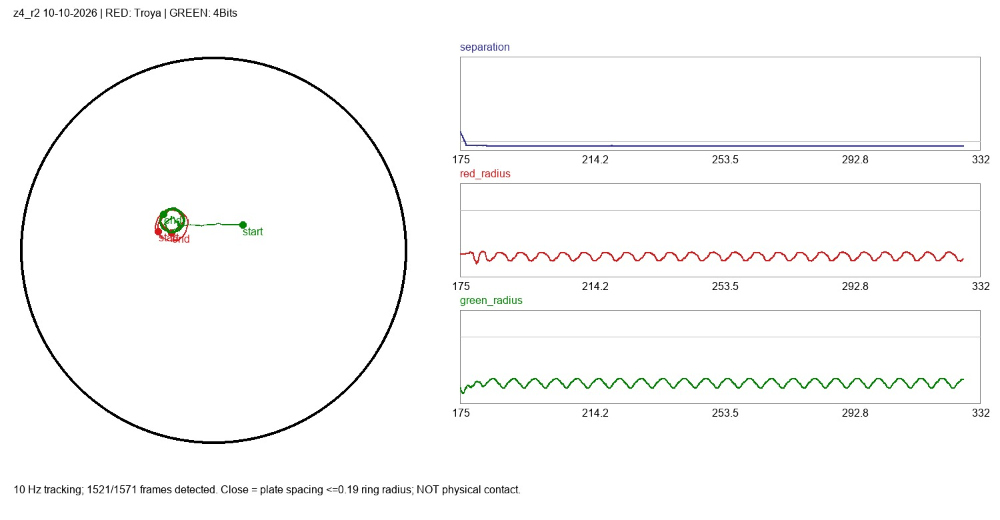

# 4Bits

Zona 4 · primero · 7 puntos.

Contra Troya, la distancia de la placa de 4Bits al centro oscila con un período de 6,4–6,5 s en dos tramos del video. Conservamos el ataque sostenido. El período medido sirve para comparar trayectorias y puede surgir de la interacción de ambos cuerpos.

- **Victoria ante LOMAS ROBOTICOS.** LOMAS hace excursiones amplias y recuperaciones hacia dentro. Desde aproximadamente 46 s mantiene proximidad con 4Bits; ambos avanzan hacia el borde inferior izquierdo con LOMAS más afuera. [Trayectoria, 32–45, 46–55 s](../../imagenes-boscobots/z4_r1_bout2.jpg)

- **Empate ante Troya.** 4Bits se aproxima a Troya. Después ambos permanecen próximos y describen un movimiento periódico pequeño en el centro, sin deriva hacia el borde durante casi toda la pelea. [Trayectoria, 175–178, 179–329 s](../../imagenes-boscobots/z4_r2_bout2.jpg)

- **Victoria ante LOS UNICOS.** 4Bits y LOS UNICOS tienen un encuentro breve. Se separan; LOS UNICOS se dirige al sector superior y sale mientras 4Bits queda por dentro, también relativamente cerca del perímetro. [Trayectoria, 8–11, 11–17 s](../../imagenes-boscobots/z4_r3_bout1.jpg)

[Estudio técnico y decisiones](estudio.md)
