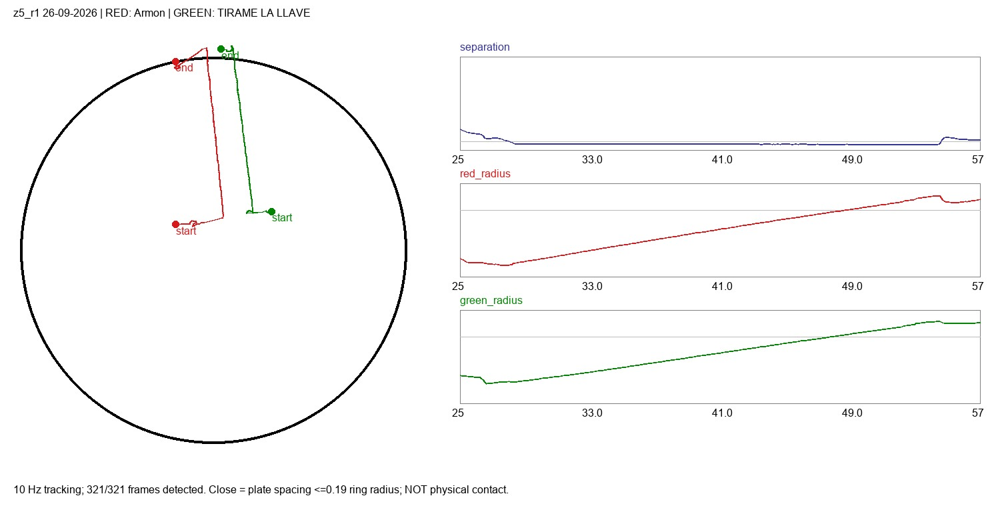

# Armon

Zona 5 · segundo · 6 puntos.

Se conserva búsqueda con giro y ataque cercano sostenido. Frente a TIRAME ambos se desplazan juntos hacia el borde durante más de veinte segundos. Frente a Nocco conviene comparar el número de reencuentros y dónde termina cada robot después de separarse.

- **Derrota ante TIRAME LA LLAVE.** Armon y TIRAME LA LLAVE cierran distancia. Durante aproximadamente 29–52 s mantienen proximidad y se desplazan hacia el borde superior. Al final cambian ligeramente su separación junto al límite. [Trayectoria, 25–29, 29–55 s](../../imagenes-boscobots/z5_r1_bout2.jpg)

- **Victoria ante Nerea.** Nerea va del sector central al borde inferior izquierdo mientras Armon permanece separado cerca del centro. No se ve un encuentro previo en esa ventana. [Trayectoria, 41–45 s](../../imagenes-boscobots/z5_r2_bout2.jpg)

- **Victoria ante BOSCO BOTS Nocco.** Armon y Nocco tienen encuentros y separaciones. Nocco hace recorridos más amplios. Tras el último acercamiento vuelve a separarse y llega al borde inferior izquierdo mientras Armon queda cerca del centro. [Trayectoria, 8–21, 22–29, 30–34 s](../../imagenes-boscobots/z5_r3_bout1.jpg)

[Estudio técnico y decisiones](estudio.md)
