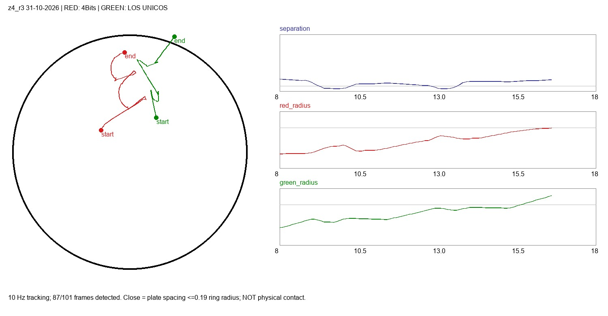

# LOS UNICOS

Zona 4 · segundo · 6 puntos.

La alternativa conserva la última orden de seguimiento hasta 512 ms cuando pierde la detección. Es una explicación posible del recorrido después de separarse de 4Bits. El video no revela cuándo dejó de verlo el sensor.

- **Victoria ante Troya.** Troya hace una excursión al borde superior derecho, vuelve hacia LOS UNICOS, se aproximan y vuelven a separarse. En el final Troya llega al borde derecho mientras LOS UNICOS permanece por dentro. [Trayectoria, 8–16, 17–21 s](../../imagenes-boscobots/z4_r1_bout1.jpg)

- **Victoria ante LOMAS ROBOTICOS.** LOS UNICOS recorre una región más interior y LOMAS hace muchas idas y vueltas al borde. Hay varios encuentros y separaciones. LOMAS acaba en el perímetro superior izquierdo separado del ganador. [Trayectoria, 8–160 s](../../imagenes-boscobots/z4_r2_bout1.jpg)

- **Derrota ante 4Bits.** 4Bits y LOS UNICOS tienen un encuentro breve. Se separan; LOS UNICOS se dirige al sector superior y sale mientras 4Bits queda por dentro, también relativamente cerca del perímetro. [Trayectoria, 8–11, 11–17 s](../../imagenes-boscobots/z4_r3_bout1.jpg)

[Estudio técnico y decisiones](estudio.md)
