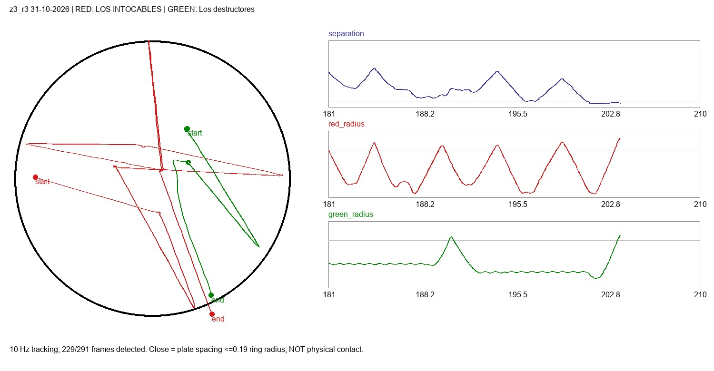

# Los destructores

Zona 3 · primero · 7 puntos.

La búsqueda central concuerda con los períodos de separación. Ensayamos un límite de persecución de 30 para mantener ese comportamiento sin perder el cierre que se ve contra TAF. La comparación pendiente exige reproducir ambos episodios.

- **Empate ante UPPER 6.** Los destructores y UPPER 6 mantienen posiciones separadas cerca del centro durante casi todo el episodio. Se observa muy poco cierre sostenido de la distancia. [Trayectoria, 8–160 s](../../imagenes-boscobots/z3_r1_bout1.jpg)

- **Victoria ante TAF.** Tras aproximaciones y cambios de dirección, Los destructores y TAF entran en proximidad. La pareja se desplaza rápidamente hacia el lado derecho, con TAF por fuera y Los destructores más por dentro. [Trayectoria, 73–78, 78–81 s](../../imagenes-boscobots/z3_r2_bout2.jpg)

- **Victoria ante LOS INTOCABLES.** LOS INTOCABLES recorre repetidamente zonas del perímetro. Los destructores permanece mucho más central, hace una aproximación intermedia y, en el encuentro final, ambos avanzan hacia el borde inferior con LOS INTOCABLES por fuera. [Trayectoria, 181–201, 201–205 s](../../imagenes-boscobots/z3_r3_bout2.jpg)

[Estudio técnico y decisiones](estudio.md)
