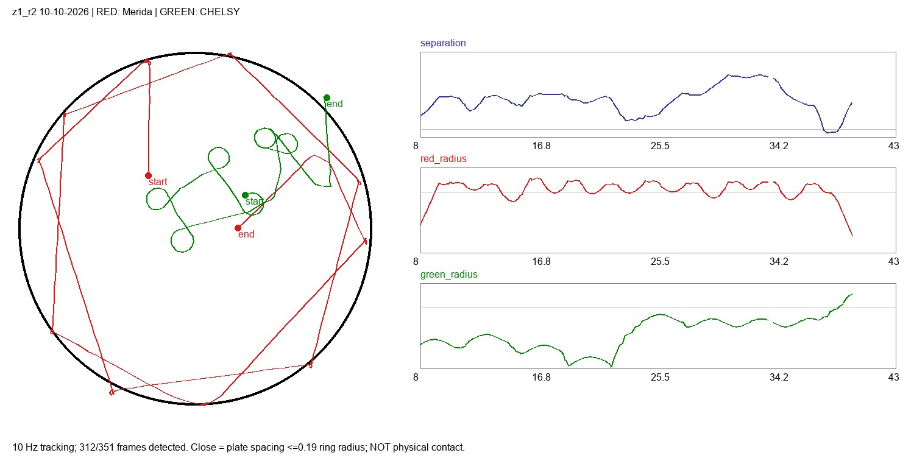

# Merida

Zona 1 · segundo · 6 puntos.

La réplica recorre el ring y gira después de detectar el borde. El brillo de 40 se eligió en pruebas con el hardware base. El contraste pendiente es si también reproduce las recuperaciones cuando hay inclinación y contacto.

- **Victoria ante BOSCO BOTS Marquez.** Merida recorre sectores amplios y vuelve desde el borde. Entre aproximadamente 61 y 118 s hay contacto casi inmóvil y la placa roja no se ve; el reloj del simulador sí avanza. Hacia 119 s cambia la ubicación de ambos, compatible con una relocalización. Tras un nuevo encuentro, Merida lleva a Marquez hacia el borde superior. [Trayectoria, 8–28, 60–118, 119–127 s](../../imagenes-boscobots/z1_r1_bout1.jpg)

- **Victoria ante CHELSY.** Merida describe recorridos amplios cerca del perímetro. CHELSY circula más por dentro y termina junto al borde superior derecho; Merida queda separada cerca del centro en las muestras finales. [Trayectoria, 8–23, 24–40 s](../../imagenes-boscobots/z1_r2_bout1.jpg)

- **Derrota ante Parachoquesitos.** Merida alterna recorridos amplios y contactos con Parachoquesitos. Hay dos fases largas de proximidad; en parte de la segunda la placa roja queda oculta y se ve inclinación. Tras separarse, Merida llega al borde inferior izquierdo mientras Parachoquesitos sigue por dentro. [Trayectoria, 8–35, 35–51, 81–103, 103–111 s](../../imagenes-boscobots/z1_r3_bout1.jpg)

[Estudio técnico y decisiones](estudio.md)
