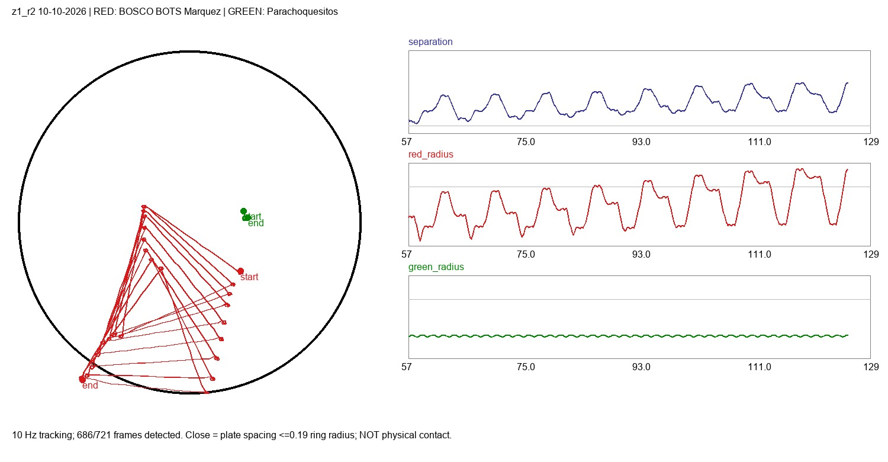

# Parachoquesitos

Zona 1 · primero · 7 puntos.

La réplica gira sobre su posición al buscar. La alternativa limita la persecución a lecturas inferiores a 12. Frente al blanco situado a 35 cm permanece cerca de su inicio. Queda por probar si responde a tiempo cuando el contrario se acerca.

- **Empate ante CHELSY.** Acercamientos y pequeñas separaciones al principio; después mantienen proximidad en un sector central durante casi todo el resto de la pelea. No hay deriva sostenida hacia la salida. [Trayectoria, 143–161, 162–295 s](../../imagenes-boscobots/z1_r1_bout2.jpg)

- **Victoria ante BOSCO BOTS Marquez.** Parachoquesitos permanece en un sector pequeño del centro. Marquez repite recorridos de ida y vuelta progresivamente más cercanos al límite inferior izquierdo. La separación final es amplia. [Trayectoria, 57–129 s](../../imagenes-boscobots/z1_r2_bout2.jpg)

- **Victoria ante Merida.** Merida alterna recorridos amplios y contactos con Parachoquesitos. Hay dos fases largas de proximidad; en parte de la segunda la placa roja queda oculta y se ve inclinación. Tras separarse, Merida llega al borde inferior izquierdo mientras Parachoquesitos sigue por dentro. [Trayectoria, 8–35, 35–51, 81–103, 103–111 s](../../imagenes-boscobots/z1_r3_bout1.jpg)

[Estudio técnico y decisiones](estudio.md)
