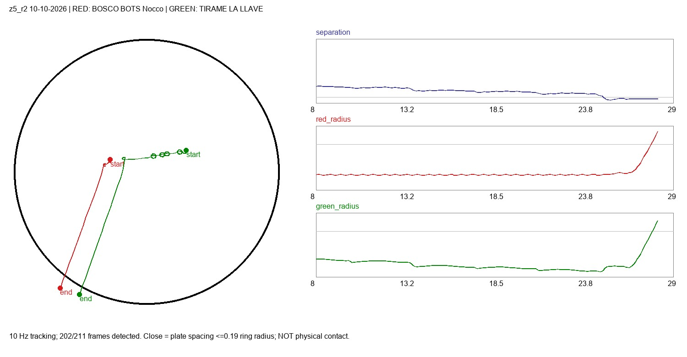

# TIRAME LA LLAVE

Zona 5 · primero · 9 puntos.

En el cierre frente a Nocco, TIRAME aporta gran parte del desplazamiento. Frente a Armon se acercan ambos. El equipo conserva como referencia una aproximación lenta seguida de avance cercano. La alternativa por impulsos acortó demasiado el tiempo de aproximación en el diagnóstico.

- **Victoria ante Armon.** Armon y TIRAME LA LLAVE cierran distancia. Durante aproximadamente 29–52 s mantienen proximidad y se desplazan hacia el borde superior. Al final cambian ligeramente su separación junto al límite. [Trayectoria, 25–29, 29–55 s](../../imagenes-boscobots/z5_r1_bout2.jpg)

- **Victoria ante BOSCO BOTS Nocco.** TIRAME LA LLAVE se aproxima lentamente mientras Nocco permanece en una región pequeña. Tras el encuentro ambos se desplazan rápidamente hacia el borde inferior izquierdo. En el final los dos quedan muy próximos al límite. [Trayectoria, 8–24, 25–28 s](../../imagenes-boscobots/z5_r2_bout1.jpg)

- **Victoria ante Nerea.** Nerea visita el borde superior, vuelve hacia el centro y pasa cerca de TIRAME LA LLAVE; luego se dirige al borde superior izquierdo. TIRAME LA LLAVE se mantiene mucho más central. [Trayectoria, 45–53, 54–59 s](../../imagenes-boscobots/z5_r3_bout2.jpg)

[Estudio técnico y decisiones](estudio.md)
