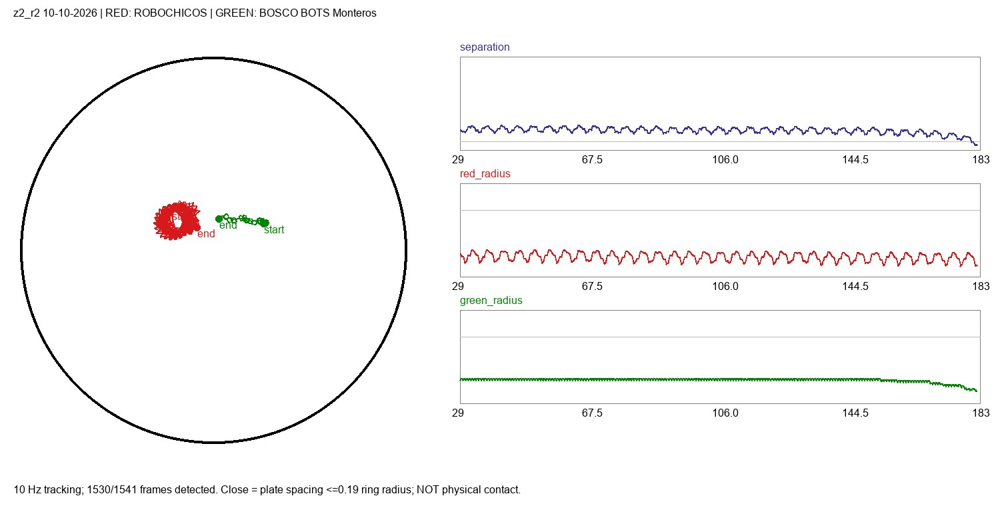
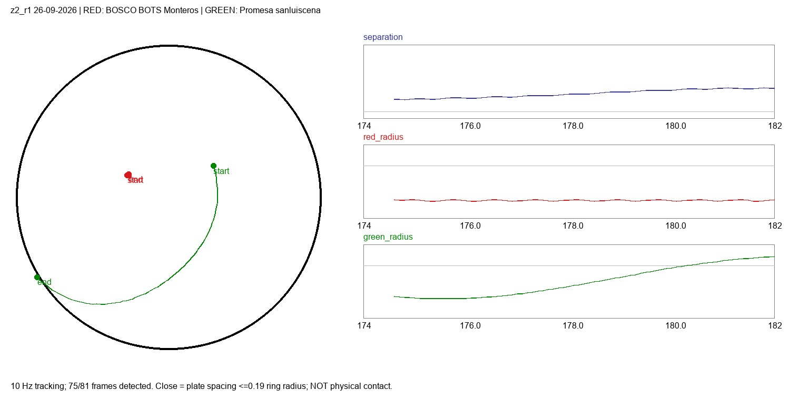
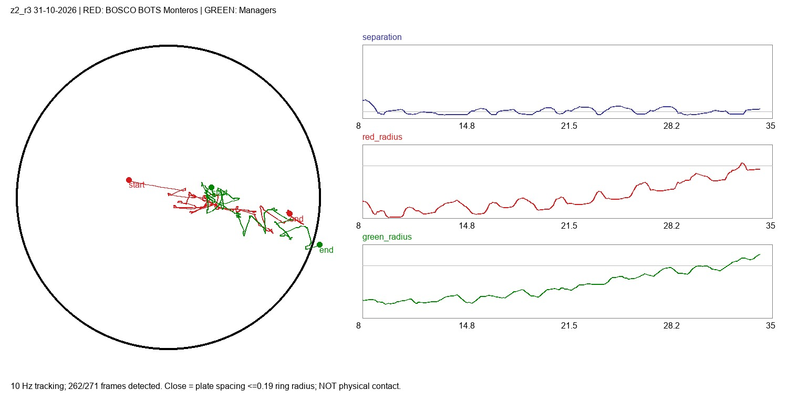
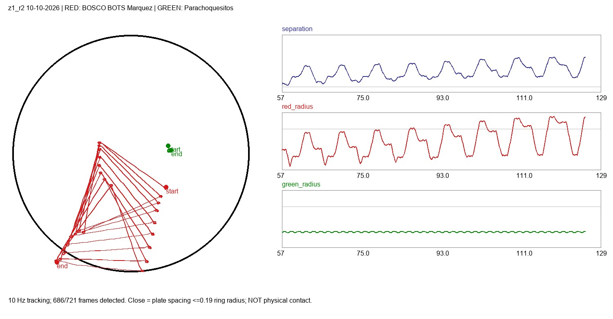
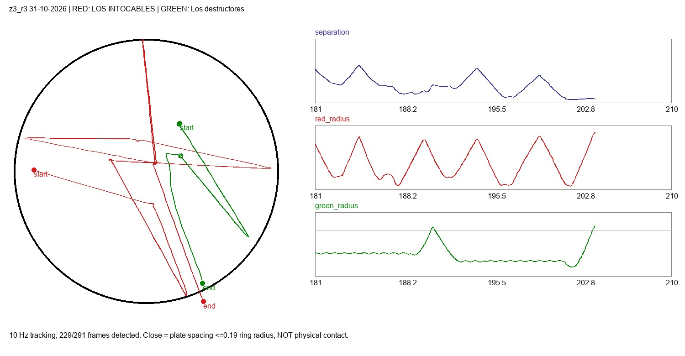
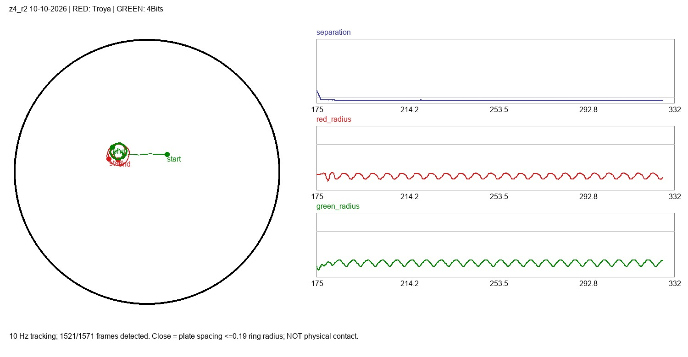
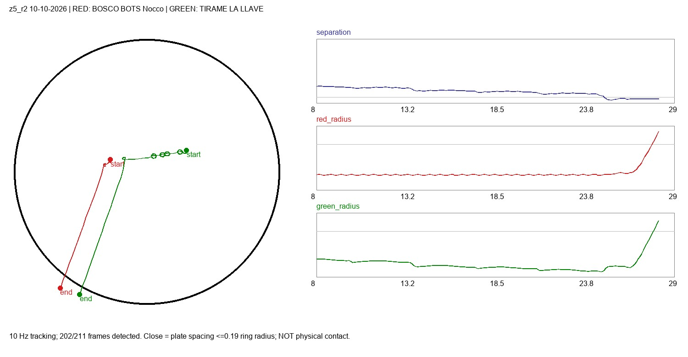
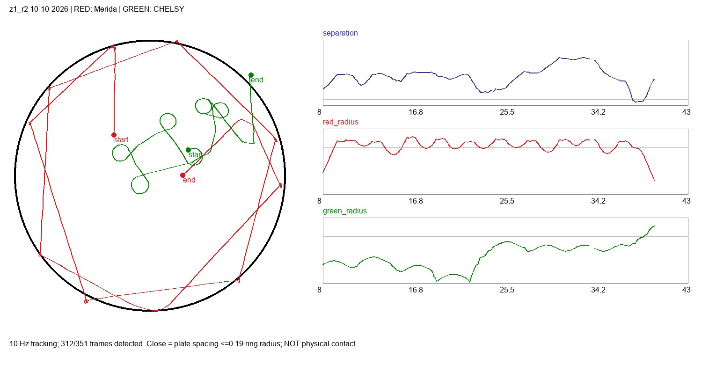
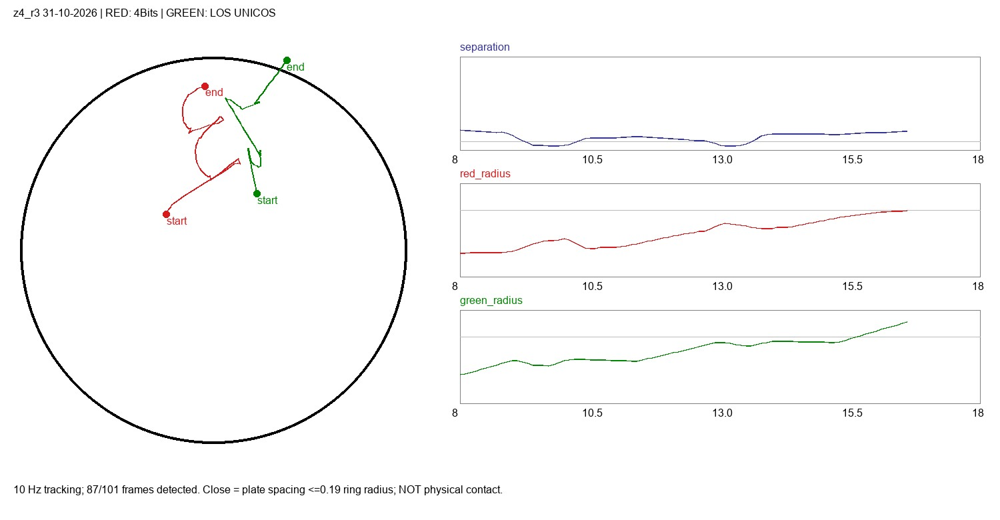
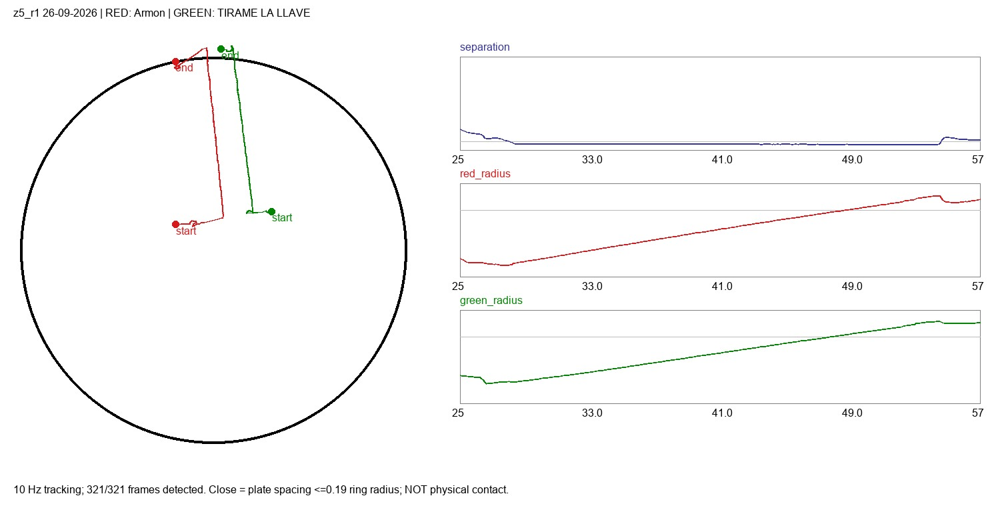

# BoscoBots Monteros en RoboLiga Virtual 2026

**Categoría SUMO · Preparación para cuartos de final · Actualización del 11 de noviembre de 2026**

BOSCO BOTS Monteros terminó primero en la zona 2 con siete puntos. Este informe reúne tres partes del trabajo del equipo: cómo toma decisiones SICHE, qué muestran las grabaciones de la fase de grupos y cómo usamos Webots para contrastar las estrategias que atribuimos a los posibles rivales.

[Análisis de próximos rivales](An%C3%A1lisis%20de%20pr%C3%B3ximos%20rivales/README.md)

## Las tres peleas de Monteros

| Ronda | Rival | Color propio | Resultado | Qué se vio |
|---|---|---|---|---|
| 1 | Promesa sanluiscena | Rojo | Victoria | Entre 175 y 181 s del video, Promesa llega al borde inferior mientras Monteros permanece en el interior. |
| 2 | ROBOCHICOS | Verde | Empate | Los dos permanecen separados cerca del centro durante gran parte de la pelea. Se agota el tiempo. |
| 3 | Managers | Rojo | Victoria | Entre 22 y 33 s hay varios encuentros. Monteros recupera el contacto y queda por dentro cuando Managers sale por la derecha. |

El empate contra ROBOCHICOS plantea un problema de búsqueda. La victoria ante Managers muestra por qué conviene conservar la capacidad de volver a encontrar al rival después de una separación. Cambiar la búsqueda puede afectar ambas situaciones.

## Cómo trabaja SICHE_estudio

El equipo desarrolla el controlador en bloques y conserva el Python exportado para ejecutarlo con RobotRL. El programa y la configuración física se cargan por separado en el mismo color. La referencia estudiada usa los dos sensores delanteros de distancia a una altura configurada de 4 mm, un sensor de brillo del piso y dos bumpers traseros.

| Situación | Decisión del controlador |
|---|---|
| Aparece la franja clara | Un brillo mayor que 85, o dos lecturas consecutivas mayores que 70, activan el retroceso a −90 en ambas ruedas. Al dejar de detectar la franja completa ocho ciclos de retroceso y diez de giro. |
| El rival queda fuera de las dos lecturas | Gira sobre su lugar a 35 en sentidos opuestos. El último lado registrado determina hacia dónde busca. |
| Solo un sensor detecta | Ordena 40 a una rueda y 100 a la otra para orientar el frente hacia la detección. |
| Detecta con ambos sensores | Al adquirir al rival avanza a 100/100. Durante el seguimiento cercano mantiene ese avance. Si las lecturas difieren en más de ocho unidades, puede corregir a 75/100 o 100/75. |
| Se activa un bumper trasero con ambas distancias en 100 o más | Avanza a 100/100. La protección del borde y su recuperación tienen prioridad. |

Estos valores son órdenes de velocidad. Para estudiar un empuje medimos por separado cuánto se desplaza cada cuerpo en el ring. El programa en competencia decide con sus propios sensores.

**Una decisión de desarrollo.** Se probó un avance breve durante la búsqueda frente a rara, Alexino v4 y Kawasaki, los tres rivales históricos de entrenamiento. En 72 escenarios por programa, SICHE_estudio obtuvo 45 victorias, 23 derrotas y 4 empates. La variante obtuvo 43 victorias, 27 derrotas y 2 empates. El avance se activó en cinco peleas. El equipo conservó SICHE_estudio y pasó a estudiar a los clasificados.

## Cómo leer las imágenes

El archivo de la fase de grupos contiene 15 grabaciones y 30 peleas. Se procesaron a diez imágenes por segundo las rondas del 26 de septiembre, 10 de octubre y 31 de octubre. Los siete posibles rivales suman 21 apariciones en 18 peleas distintas porque tres enfrentamientos involucran a dos de ellos.

En cada panel, el mapa de la izquierda reconstruye el recorrido de las placas roja y verde. A la derecha, la curva superior indica su separación y las otras dos muestran cuánto se aleja cada placa del centro. Los tiempos corresponden al archivo de video. La inclinación puede ocultar una placa y producir huecos. La cercanía en pantalla orienta la revisión visual, pero identificar la fuerza, una lectura de bumper o una orden de rueda requiere otros datos.

## Los siete posibles rivales

Pasaron los cinco ganadores de zona y los tres segundos con más puntos. El fixture analizado permite identificar los equipos. El cruce de Monteros no figura en ese material. Cada ficha distingue lo observado en el torneo de lo que se programó en la réplica.

### Parachoquesitos

Zona 1 · primero · 7 puntos.

La réplica gira sobre su posición al buscar. La alternativa limita la persecución a lecturas inferiores a 12. Frente al blanco situado a 35 cm permanece cerca de su inicio. Queda por probar si responde a tiempo cuando el contrario se acerca.

- **Empate ante CHELSY.** Acercamientos y pequeñas separaciones al principio; después mantienen proximidad en un sector central durante casi todo el resto de la pelea. No hay deriva sostenida hacia la salida. [Trayectoria, 143–161, 162–295 s](imagenes-boscobots/z1_r1_bout2.jpg)

- **Victoria ante BOSCO BOTS Marquez.** Parachoquesitos permanece en un sector pequeño del centro. Marquez repite recorridos de ida y vuelta progresivamente más cercanos al límite inferior izquierdo. La separación final es amplia. [Trayectoria, 57–129 s](imagenes-boscobots/z1_r2_bout2.jpg)

- **Victoria ante Merida.** Merida alterna recorridos amplios y contactos con Parachoquesitos. Hay dos fases largas de proximidad; en parte de la segunda la placa roja queda oculta y se ve inclinación. Tras separarse, Merida llega al borde inferior izquierdo mientras Parachoquesitos sigue por dentro. [Trayectoria, 8–35, 35–51, 81–103, 103–111 s](imagenes-boscobots/z1_r3_bout1.jpg)

### Los destructores

Zona 3 · primero · 7 puntos.

La búsqueda central concuerda con los períodos de separación. Ensayamos un límite de persecución de 30 para mantener ese comportamiento sin perder el cierre que se ve contra TAF. La comparación pendiente exige reproducir ambos episodios.

- **Empate ante UPPER 6.** Los destructores y UPPER 6 mantienen posiciones separadas cerca del centro durante casi todo el episodio. Se observa muy poco cierre sostenido de la distancia. [Trayectoria, 8–160 s](imagenes-boscobots/z3_r1_bout1.jpg)

- **Victoria ante TAF.** Tras aproximaciones y cambios de dirección, Los destructores y TAF entran en proximidad. La pareja se desplaza rápidamente hacia el lado derecho, con TAF por fuera y Los destructores más por dentro. [Trayectoria, 73–78, 78–81 s](imagenes-boscobots/z3_r2_bout2.jpg)

- **Victoria ante LOS INTOCABLES.** LOS INTOCABLES recorre repetidamente zonas del perímetro. Los destructores permanece mucho más central, hace una aproximación intermedia y, en el encuentro final, ambos avanzan hacia el borde inferior con LOS INTOCABLES por fuera. [Trayectoria, 181–201, 201–205 s](imagenes-boscobots/z3_r3_bout2.jpg)

### 4Bits

Zona 4 · primero · 7 puntos.

Contra Troya, la distancia de la placa de 4Bits al centro oscila con un período de 6,4–6,5 s en dos tramos del video. Conservamos el ataque sostenido. El período medido sirve para comparar trayectorias y puede surgir de la interacción de ambos cuerpos.

- **Victoria ante LOMAS ROBOTICOS.** LOMAS hace excursiones amplias y recuperaciones hacia dentro. Desde aproximadamente 46 s mantiene proximidad con 4Bits; ambos avanzan hacia el borde inferior izquierdo con LOMAS más afuera. [Trayectoria, 32–45, 46–55 s](imagenes-boscobots/z4_r1_bout2.jpg)

- **Empate ante Troya.** 4Bits se aproxima a Troya. Después ambos permanecen próximos y describen un movimiento periódico pequeño en el centro, sin deriva hacia el borde durante casi toda la pelea. [Trayectoria, 175–178, 179–329 s](imagenes-boscobots/z4_r2_bout2.jpg)

- **Victoria ante LOS UNICOS.** 4Bits y LOS UNICOS tienen un encuentro breve. Se separan; LOS UNICOS se dirige al sector superior y sale mientras 4Bits queda por dentro, también relativamente cerca del perímetro. [Trayectoria, 8–11, 11–17 s](imagenes-boscobots/z4_r3_bout1.jpg)

### TIRAME LA LLAVE

Zona 5 · primero · 9 puntos.

En el cierre frente a Nocco, TIRAME aporta gran parte del desplazamiento. Frente a Armon se acercan ambos. El equipo conserva como referencia una aproximación lenta seguida de avance cercano. La alternativa por impulsos acortó demasiado el tiempo de aproximación en el diagnóstico.

- **Victoria ante Armon.** Armon y TIRAME LA LLAVE cierran distancia. Durante aproximadamente 29–52 s mantienen proximidad y se desplazan hacia el borde superior. Al final cambian ligeramente su separación junto al límite. [Trayectoria, 25–29, 29–55 s](imagenes-boscobots/z5_r1_bout2.jpg)

- **Victoria ante BOSCO BOTS Nocco.** TIRAME LA LLAVE se aproxima lentamente mientras Nocco permanece en una región pequeña. Tras el encuentro ambos se desplazan rápidamente hacia el borde inferior izquierdo. En el final los dos quedan muy próximos al límite. [Trayectoria, 8–24, 25–28 s](imagenes-boscobots/z5_r2_bout1.jpg)

- **Victoria ante Nerea.** Nerea visita el borde superior, vuelve hacia el centro y pasa cerca de TIRAME LA LLAVE; luego se dirige al borde superior izquierdo. TIRAME LA LLAVE se mantiene mucho más central. [Trayectoria, 45–53, 54–59 s](imagenes-boscobots/z5_r3_bout2.jpg)

### Merida

Zona 1 · segundo · 6 puntos.

La réplica recorre el ring y gira después de detectar el borde. El brillo de 40 se eligió en pruebas con el hardware base. El contraste pendiente es si también reproduce las recuperaciones cuando hay inclinación y contacto.

- **Victoria ante BOSCO BOTS Marquez.** Merida recorre sectores amplios y vuelve desde el borde. Entre aproximadamente 61 y 118 s hay contacto casi inmóvil y la placa roja no se ve; el reloj del simulador sí avanza. Hacia 119 s cambia la ubicación de ambos, compatible con una relocalización. Tras un nuevo encuentro, Merida lleva a Marquez hacia el borde superior. [Trayectoria, 8–28, 60–118, 119–127 s](imagenes-boscobots/z1_r1_bout1.jpg)

- **Victoria ante CHELSY.** Merida describe recorridos amplios cerca del perímetro. CHELSY circula más por dentro y termina junto al borde superior derecho; Merida queda separada cerca del centro en las muestras finales. [Trayectoria, 8–23, 24–40 s](imagenes-boscobots/z1_r2_bout1.jpg)

- **Derrota ante Parachoquesitos.** Merida alterna recorridos amplios y contactos con Parachoquesitos. Hay dos fases largas de proximidad; en parte de la segunda la placa roja queda oculta y se ve inclinación. Tras separarse, Merida llega al borde inferior izquierdo mientras Parachoquesitos sigue por dentro. [Trayectoria, 8–35, 35–51, 81–103, 103–111 s](imagenes-boscobots/z1_r3_bout1.jpg)

### LOS UNICOS

Zona 4 · segundo · 6 puntos.

La alternativa conserva la última orden de seguimiento hasta 512 ms cuando pierde la detección. Es una explicación posible del recorrido después de separarse de 4Bits. El video no revela cuándo dejó de verlo el sensor.

- **Victoria ante Troya.** Troya hace una excursión al borde superior derecho, vuelve hacia LOS UNICOS, se aproximan y vuelven a separarse. En el final Troya llega al borde derecho mientras LOS UNICOS permanece por dentro. [Trayectoria, 8–16, 17–21 s](imagenes-boscobots/z4_r1_bout1.jpg)

- **Victoria ante LOMAS ROBOTICOS.** LOS UNICOS recorre una región más interior y LOMAS hace muchas idas y vueltas al borde. Hay varios encuentros y separaciones. LOMAS acaba en el perímetro superior izquierdo separado del ganador. [Trayectoria, 8–160 s](imagenes-boscobots/z4_r2_bout1.jpg)

- **Derrota ante 4Bits.** 4Bits y LOS UNICOS tienen un encuentro breve. Se separan; LOS UNICOS se dirige al sector superior y sale mientras 4Bits queda por dentro, también relativamente cerca del perímetro. [Trayectoria, 8–11, 11–17 s](imagenes-boscobots/z4_r3_bout1.jpg)

### Armon

Zona 5 · segundo · 6 puntos.

Se conserva búsqueda con giro y ataque cercano sostenido. Frente a TIRAME ambos se desplazan juntos hacia el borde durante más de veinte segundos. Frente a Nocco conviene comparar el número de reencuentros y dónde termina cada robot después de separarse.

- **Derrota ante TIRAME LA LLAVE.** Armon y TIRAME LA LLAVE cierran distancia. Durante aproximadamente 29–52 s mantienen proximidad y se desplazan hacia el borde superior. Al final cambian ligeramente su separación junto al límite. [Trayectoria, 25–29, 29–55 s](imagenes-boscobots/z5_r1_bout2.jpg)

- **Victoria ante Nerea.** Nerea va del sector central al borde inferior izquierdo mientras Armon permanece separado cerca del centro. No se ve un encuentro previo en esa ventana. [Trayectoria, 41–45 s](imagenes-boscobots/z5_r2_bout2.jpg)

- **Victoria ante BOSCO BOTS Nocco.** Armon y Nocco tienen encuentros y separaciones. Nocco hace recorridos más amplios. Tras el último acercamiento vuelve a separarse y llega al borde inferior izquierdo mientras Armon queda cerca del centro. [Trayectoria, 8–21, 22–29, 30–34 s](imagenes-boscobots/z5_r3_bout1.jpg)

## Qué comprobamos en Webots

Se ensayaron 22 controladores en rojo y verde con dos disposiciones iniciales, para un total de **88 diagnósticos completos de 20,48 segundos**. Una prueba deja al otro robot apartado para observar la búsqueda. La otra coloca un blanco inicialmente inmóvil a 35 cm frente al modelo. Para cada equipo se conservaron dos hipótesis sobre el bumper trasero: H0 ignora esa entrada y H1 ordena avanzar. El hardware base fue común a los rivales porque sus configuraciones de competencia son desconocidas.

La tabla registra el primer instante en que los centros quedan a menos de 15 cm en la segunda prueba. En esta medición los tiempos coincidieron entre colores y entre H0 y H1. Las trayectorias posteriores sí pueden diferir.

| Réplica | Modelo de referencia | Alternativa |
|---|---:|---:|
| Parachoquesitos | 0,928 s | Fuera de 15 cm durante toda la prueba |
| Los destructores | 0,672 s | 1,088 s |
| 4Bits | 2,368 s | — |
| TIRAME LA LLAVE | 10,720 s | 3,712 s |
| Merida | 0,576 s | — |
| LOS UNICOS | 0,640 s | 0,576 s |
| Armon | 0,800 s | — |

El resultado de TIRAME cambió una decisión concreta. Los impulsos se diseñaron para imitar sus pausas ante Nocco, pero en Webots la variante alcanzó el blanco siete segundos antes que el modelo lento. Para Parachoquesitos quedó abierta la pregunta inversa: la alternativa reproduce la permanencia en el centro, aunque podría perder un encuentro que el equipo real sí aprovecha.

## Estado del trabajo

SICHE_estudio sigue como referencia de Monteros. Los siete controladores de rivales son aproximaciones construidas a partir de grabaciones. Su fidelidad en una pelea completa sigue pendiente. La próxima comparación requiere rivales móviles, ambos colores y seguimiento de la aproximación, el contacto, la separación y la salida. En particular, Parachoquesitos–Merida, 4Bits–LOS UNICOS y TIRAME–Armon ofrecen encuentros reales entre dos equipos ya modelados.

**Fuentes del equipo.** Fixture de SUMO, seguimiento de placas de las rondas 1–3, exportación de SICHE_estudio y resultados de Webots. Se adjuntan las mediciones de las 88 pruebas para consultar cada versión y color. [Datos de los diagnósticos](datos-boscobots/diagnosticos-88.json)

