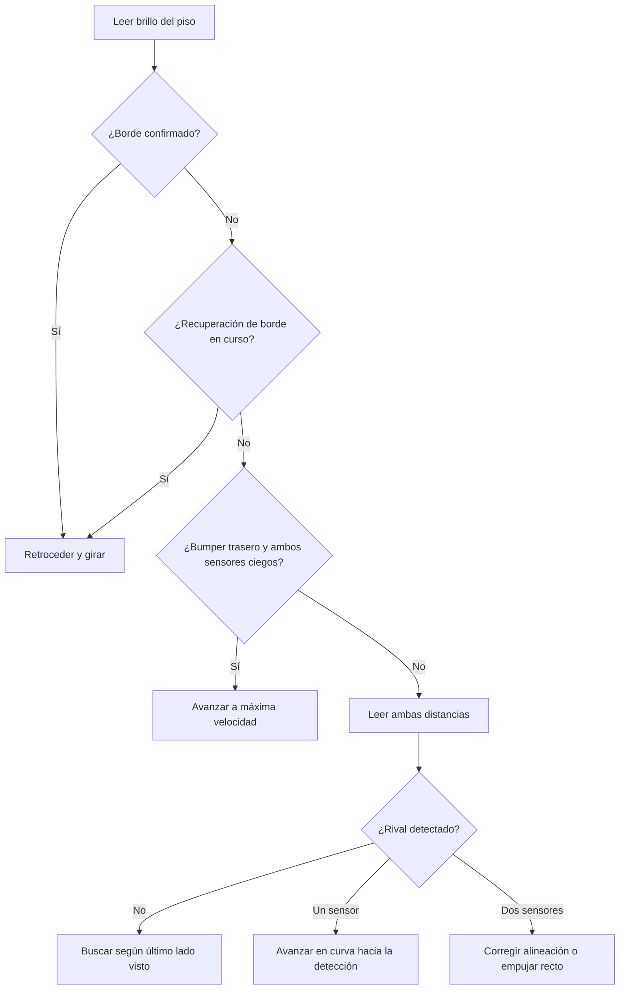

# SICHE_estudio

**Programa recomendado para RoboLiga Virtual**  
**Versión documentada:** 18 de octubre de 2026  
**Archivos:** [`SICHE_estudio.py`](SICHE_estudio.py) · [`SICHE_estudio.blocks`](SICHE_estudio.blocks) · [`SICHE_estudio.json`](SICHE_estudio.json)

## 1. Qué se entrega

Este paquete contiene la versión de SICHE que mejor respaldo experimental tiene hasta ahora. El `.py` es el programa que ejecuta el robot; el `.blocks` permite abrir y editar ese mismo programa en el editor de bloques; el `.json` configura las posiciones de sus tres sensores. Los tres archivos conservan el mismo nombre de base para facilitar su carga conjunta.

**No es una variante experimental.** Los ensayos posteriores de giros, rescates y cambios de sensores no demostraron una mejora equilibrada frente a rara, Alexino y Kawasaki. Por eso este paquete conserva `SICHE_estudio` sin modificaciones.

## 2. Cómo trabaja SICHE

SICHE toma decisiones con sus dos sensores frontales de distancia (`DI`, `DD`), el sensor de brillo del piso y los dos bumpers traseros (`BI`, `BD`). No sabe qué rival tiene enfrente ni conoce su posición absoluta en el ring. Su control se evalúa en ciclos de simulación de 32 ms y no utiliza esperas que bloqueen una nueva lectura del borde.

### Prioridad del borde

Una lectura de brillo superior a **85** provoca una reacción inmediata. También se confirma el borde si el brillo supera **70 durante dos ciclos consecutivos**. SICHE ordena entonces −90/−90; el contador mantiene ocho ciclos adicionales de retroceso y luego ordena diez ciclos de giro 60/−60. Si el sensor sigue viendo brillo de borde, la reacción puede reiniciarse. Esta prioridad se revisa antes del seguimiento del rival o de los bumpers.

### Búsqueda y aproximación

- Sin detección válida, gira a ±35 usando `UltimoLado`, el lado donde vio al rival más recientemente.
- Con un solo sensor válido, avanza en curva: **40/100** o **100/40**. Así sigue acercándose mientras alinea el frente.
- Con ambos sensores válidos, corrige a **75/100** o **100/75** si sus lecturas difieren más de 8 unidades. Si están aproximadamente alineadas, avanza **100/100**.
- Cuando ambas lecturas son menores de **12**, prioriza el empuje recto **100/100**.

El valor **100** en los sensores de distancia significa ausencia de detección útil para esta lógica; las lecturas válidas van de 0 a menos de 100. Las velocidades son órdenes a las ruedas dentro de −100 a 100: **100 no es una medida de fuerza real ni garantiza avance físico**.

### Bumpers traseros

Si se presiona alguno de los bumpers traseros mientras ambos sensores frontales están ciegos, SICHE ordena **100/100**. La intención es recuperar orientación y contacto sin quedarse girando a ciegas. Si ve al rival con un sonar, el seguimiento por distancia conserva el control. El programa contiene tres ramas equivalentes para ambos bumpers o cada uno por separado; producen la misma orden.

### Posición de los sensores

El JSON mantiene las rotaciones y los demás atributos del robot; solo fija las coordenadas de los tres sensores existentes. Las posiciones locales cargadas son:

| Sensor | X | Y | Z |
|---|---:|---:|---:|
| Distancia izquierda | −22 mm | +4 mm | −40 mm |
| Distancia derecha | +22 mm | +4 mm | −40 mm |
| Piso | 0 mm | −10 mm | −40 mm |

La altura de **4 mm** de los sensores frontales forma parte de esta versión. El programa y el JSON se cargan por separado: cargar únicamente el `.py` no aplica estas posiciones.

## 3. Qué hacen los otros robots

Estas descripciones provienen de los archivos Python recibidos. En las simulaciones se utilizaron sus modelos base disponibles; **no conocemos los JSON con que fueron configurados en otras competencias**.

| Rival | Comportamiento principal | Qué exige de SICHE |
|---|---|---|
| **rara / TURBOTASTIC** | Comienza con un giro corto. Avanza 100/100 si lo ven ambos sensores; con uno solo gira sobre su eje a ±80. Si no ve al rival, sigue girando hacia el último lado conocido. Ante piso brillante (>90), retrocede y realiza un giro de duración y dirección aleatorias. | Puede reaccionar muy rápido a una detección lateral. SICHE necesita conservar presión sin convertir cada lectura unilateral en una rotación larga. |
| **Alexino v4** | Comienza retrocediendo. Usa mucho los bumpers traseros: al presionarse, ordena retroceso a −100/−100. También retrocede ante dos distancias extremadamente cercanas (<3) y realiza giros temporizados con detecciones laterales muy próximas. Su corrección de borde contiene esperas. | Es el rival más difícil de esta muestra. En muchas derrotas levanta el frente de SICHE y lo empuja hacia afuera, donde los sensores frontales pueden perder lectura del oponente o del borde. |
| **Kawasaki** | Busca girando. Con ambas distancias ≤80 avanza 100/100; con una sola gira sobre su eje a ±60. Ante brillo >90 retrocede a −70/−70 durante dos segundos y gira un segundo. Después de la primera detección, puede conservar la última orden al perder al rival. | La entrada y el giro lateral son rápidos, pero su reacción de borde bloquea nuevas decisiones durante bastante tiempo. SICHE debe llegar alineado y mantener su control de borde activo. |

Copiar literalmente una táctica rival no garantiza mejorar a SICHE. Probamos giros continuos y pulsos breves de un solo sensor, inspirados en rara y Kawasaki: el continuo bajó claramente las victorias; el pulso ayudó frente a Kawasaki, pero perdió resultados contra rara y Alexino. La retirada de Alexino por bumper no se añadió porque SICHE no tiene un sensor que confirme a tiempo el borde detrás suyo.

## 4. Resultados medidos

### Comparación histórica de la versión recomendada

En el protocolo histórico, SICHE_estudio ganó **62 de 108** peleas: **25/36** ante rara, **11/36** ante Alexino y **26/36** ante Kawasaki. Esta cifra identifica al programa recomendado y sirve de referencia histórica; no promete el mismo porcentaje en una pelea futura.

### Tanda reciente con ambos colores

En una tanda posterior bajo una **réplica de las reglas de la aplicación**, SICHE_estudio fue ejecutado como rojo y como verde, con tres orientaciones iniciales y ambos lados físicos. Esta fue la referencia emparejada para el ensayo del pulso de un sensor; se cuentan solo peleas completas.

| Color de SICHE | Rival | Victorias | Derrotas | Empates | Anulaciones |
|---|---|---:|---:|---:|---:|
| Rojo | rara | 8 | 4 | 0 | 0 |
| Rojo | Alexino | 4 | 7 | 1 | 0 |
| Rojo | Kawasaki | 8 | 4 | 0 | 0 |
| **Rojo** | **Total** | **20** | **15** | **1** | **0** |
| Verde | rara | 10 | 1 | 1 | 0 |
| Verde | Alexino | 4 | 8 | 0 | 0 |
| Verde | Kawasaki | 7 | 3 | 1 | 1 |
| **Verde** | **Total** | **21** | **12** | **2** | **1** |
| **Ambos** | **Total** | **41/72** | **27** | **3** | **1** |

**Cómo leer las cifras:** 62/108 y 41/72 proceden de protocolos y condiciones distintas. No representan dos versiones de SICHE ni una mejora o caída comprobada entre sí. En otra tanda nueva, la misma referencia también obtuvo 41/72, pero la distribución entre rojo y verde cambió. Por eso no concluimos que un color sea intrínsecamente mejor. Las semillas y poses se emparejan cuando se compara una variante contra la referencia, aunque la física puede divergir tras órdenes distintas.

La debilidad más persistente es Alexino: SICHE pierde más encuentros contra él que frente a los otros dos. Los registros mostraron desplazamiento hacia afuera con el frente elevado y el sensor de piso sin confirmar a tiempo el borde posterior. Se estudiaron rescates frontales, señales de bumper e inclinación y cambios de posición del sensor, pero ninguno justificó sustituir esta versión sin perjudicar el promedio.

## 5. Cómo cargarlo

1. Extraé el ZIP y mantené **`SICHE_estudio.py` y `SICHE_estudio.blocks` juntos en la misma carpeta**, con esos nombres. Abrí el programa desde el editor de bloques; el `.blocks` contiene los bloques correspondientes al `.py`.
2. En la aplicación de RoboLiga/Webots, elegí el color con el que participará SICHE y cargá **`SICHE_estudio.py`** en el botón de programa de ese color.
3. En el botón **Robot base del mismo color**, cargá **`SICHE_estudio.json`**. Comprobá que la aplicación muestre el programa y la configuración correctos para ese color.
4. Después de reiniciar una simulación, revisá otra vez ambos indicadores. El programa y el hardware son selecciones independientes.

Conservá esta carpeta como respaldo antes de editar bloques o posiciones. Si probás una variante futura, comparala siempre contra estos tres archivos sin modificarlos y con SICHE en **rojo y verde**.

## 6. Estado de la recomendación

`SICHE_estudio` es la versión recomendada porque las propuestas posteriores no superaron una comparación equilibrada. Todavía puede haber margen de mejora, pero una idea nueva debe demostrar más victorias contra los tres rivales sin depender de información que el robot no puede medir. Ninguna cifra de simulación garantiza el resultado de una competencia real.

---

**Líder del proyecto:** Laureano Monteros  
**Sitio web personal:** pendiente de agregar  
**Contacto:** pendiente de agregar
